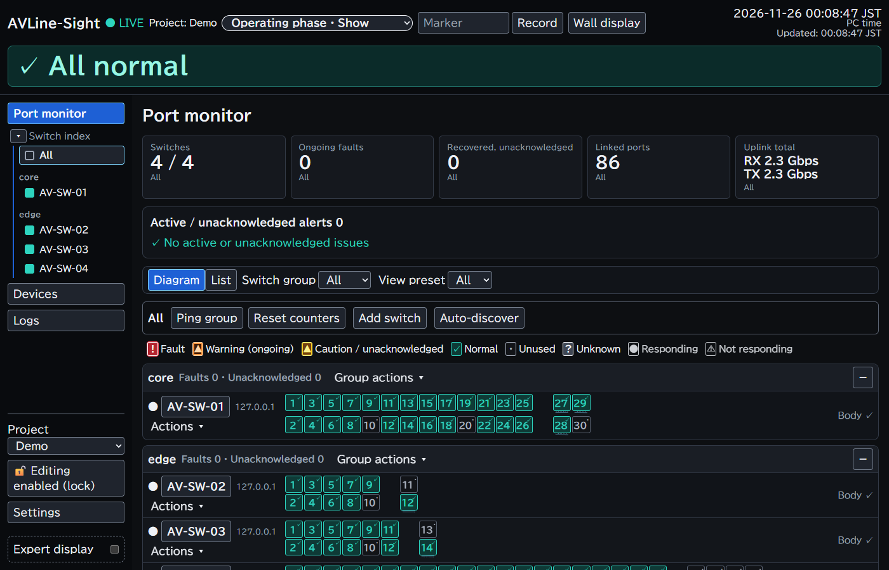
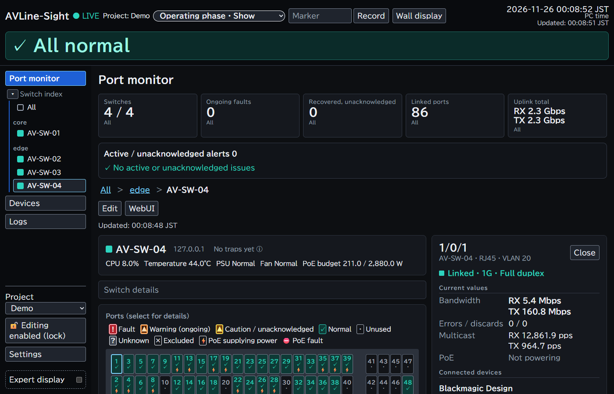
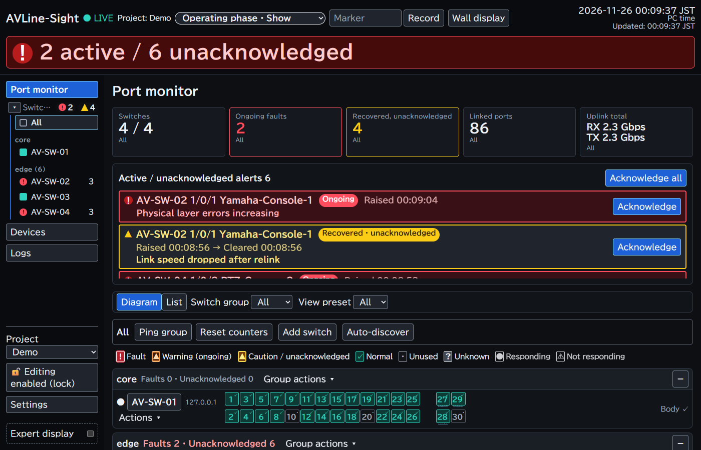

# AVLine-Sight

AVLine-Sight monitors AV over IP networks built with NETGEAR AV Line (M4250 series) switches, including Dante, AES67, NDI, SDVoE, ST 2110, Q-SYS, sACN and AVB.
It ships as one portable Windows executable with the web UI built in. By default, it stores monitoring data under `./data/` next to the executable.

> **Unofficial.** AVLine-Sight is an independent project and is not affiliated with, endorsed by, or supported by NETGEAR. NETGEAR, AV Line and M4250 are names or trademarks of NETGEAR, Inc., used here only to identify the switches this tool works with. Other product names (Dante, Q-SYS and so on) belong to their respective owners.

日本語版は [README_JP.md](README_JP.md) を参照してください。

## Screenshots

All screenshots use the built-in lab (virtual switches), not real equipment.

| Port monitor (all switches) | One switch and port detail | When a fault occurs |
|---|---|---|
|  |  |  |

## Monitoring screens

- **Port monitor** opens at startup. Switch between Diagram (rack view) and List to check switches and ports. The alert band shows active and unacknowledged alerts. The overall status covers all switches, including when the view is filtered by group.
- **Devices** shows observed and registered devices, their switch and port, planned and observed IP addresses, and the latest ping result. You can export the list as CSV.
- **Logs** shows events and markers in time order. Use filters to find issues and warnings, unacknowledged events or markers. Times shown in the log are PC receive times in JST.
- **Wall display** shows current status by switch and highlights unacknowledged alerts for a shared monitor.
- **Expert display** is off by default. Turn it on in Settings to open Details, Topology and the Telnet/SSH Terminal. Details includes Multicast / AV, DHCP, Health / Audit, Configuration changes and Settings that differ from recommendations. The terminal connects only to registered switches, stores no credentials and disconnects after 10 minutes of inactivity.

## Operating phases and post-show report

| Phase | Monitoring behavior |
|---|---|
| Setup | Periodically pings registered devices. Suppresses port alerts, missing devices, ping failures and IP mismatches. Fast and Medium polling intervals are multiplied by three, and Slow by two. |
| Rehearsal | Enables all alerts, periodically pings registered devices and uses the configured polling intervals. |
| Show | Enables all alerts and uses the configured polling intervals. Periodic ping stops. |

When switching to Show, review the **Pre-show checklist**. It checks switch reachability, trap receipt, clock offset, registered devices and alert status, among other items. If any items are pending or need review, explicitly confirm them to start the show. The app logs the remaining items and saves a baseline when the show starts.

**Post-show report (CSV)** in Settings exports the latest recorded show period. Use the same button in Logs to export the period between the selected start and end times. The CSV includes phase changes, remaining checklist items, markers, and alert activity such as occurrences, recoveries and acknowledgements. Timestamps are in JST.

## Monitoring features

- SNMPv2c uses three polling tiers (Fast / Medium / Slow). Each switch has an independent worker. Unresponsive switches back off from 5 to 15 to 30 seconds.
- SNMP traps cover linkUp/Down, LLDP, PoE, fans, PSUs, temperature, STP, IP conflicts and CPU. Unknown traps are stored with their raw OID.
- Switch health includes CPU (5s/60s/300s), per-process CPU, memory, Mbuf, temperature, fans, PSUs and reboot detection via sysUpTime. `CLOCK_SKEW` warns when a measured switch clock differs from the monitoring PC by more than 60 seconds. Check time synchronization on both devices.
- Device identification uses LLDP, DHCP Snooping, ARP, FDB with an OUI vendor dictionary, and manual labels. Connection history is shown on a timeline.
- AV checks cover IGMP querier status, multicast groups by port, EEE/LPI, PAUSE frames with an NDI4 exception, CoS queue drops, DSCP Trust, FrameTooLongs (MTU mismatch), UDLD, SFP DOM, PoE faults, STP/MSTP and duplicate or rogue DHCP servers. Expert display also provides cross-switch audits based on the NETGEAR ProAV Guide.
- Detected changes to monitored port settings, such as PVID, EEE and maximum frame size, appear in Logs as `PORT_CONFIG_CHANGED` events with before and after values. Expert display provides a comparison with the latest baseline and a list of recent configuration changes.
- Save and compare baselines, add an incident marker with `M`, export an `.avsight` session for offline replay, and export monitoring data as CSV or JSON.
- Each port's VLAN mode (Access / Trunk / General) and the VLANs it carries are read, and a role mark appears under the port number in the rack view (see Glossary below). Inter-switch links in Topology show the VLANs carried at both ends.
- `VLAN_TRUNK_MISMATCH` warns when a VLAN that exists on both switches is carried on only one end of an inter-switch link. A VLAN that the other switch does not have at all is treated as intentionally local and is not reported.
- When a switch reports only the MAC address of a multicast group, the IP address and purpose are estimated from known uses (Dante, mDNS, VRRP and others).

## Glossary

| Mark or term | Meaning |
|---|---|
| T (Trunk) | A port that links switches and carries several VLANs together. A trunk whose LLDP neighbor is a NETGEAR switch is shown as "likely Auto-Trunk" (the switch does not report over SNMP whether it was set automatically). |
| G (General) | A port with VLANs set individually, carrying two or more. The M4250 reports ordinary device ports as General too, so a General port carrying only one VLAN has no mark. |
| L (LAG) | A member port of a LAG, which bundles several links to act as one. |
| B (STP blocked) | A port where the switch stops traffic to prevent a loop. Check that it is an intended redundant path. |
| Querier | The switch that sends IGMP queries to find multicast listeners. Each VLAN needs one. |
| (estimated) | A value not read directly from the switch but estimated from other information. |

Drag the dividers between the left pane and the main area, and between the port list and port details, to change their widths (←/→ keys also work; double-click to reset).

## Quick start

Double-click `avline-sight.exe`. No console window opens: the web UI opens in your browser and an icon appears in the notification area (system tray).

- Double-click the tray icon to open the web UI again.
- Right-click it for **Open**, **Copy URL** (handy for opening the UI from another PC) and **Quit**. Quit stops monitoring and closes the database safely.
- Only one copy can run per data folder. Starting it again shows a message instead; use the tray icon.
- Logs go to `avline-sight.log` in the data folder (up to 10 MB; one older file `avline-sight.log.1` is kept). Startup errors appear in a message box.

When started from PowerShell, messages and `--help` appear in that window:

```powershell
.\avline-sight.exe --open
```

The default WebUI address is `localhost:8080`. If the app cannot listen on UDP 162 for traps, it continues monitoring and shows a warning. The Windows SNMP Trap service may be using the port, or the app may lack permission. Change the listening port at startup with `--trap` (for example `--trap 0.0.0.0:1162`).

| Flag | Default | Meaning |
|---|---|---|
| `--listen` | `127.0.0.1:8080` | WebUI listen address. If the port is busy, the app tries up to 20 higher ports. |
| `--trap` | Saved address or `0.0.0.0:162` | SNMP trap listen address. |
| `--data` | `<exe directory>/data` | Database directory. |
| `--config` | First-start lookup described below | Apply a JSON configuration file at startup. An explicitly supplied file is applied even if data already exists. |
| `--fast/--medium/--slow` | `3s/12s/45s` | Polling intervals. |

## Configuration file

In **Settings**, use **Import configuration file** to select a JSON file and review the differences. Applying it creates and activates a new profile. Use **Export configuration file** to save the current profile as `avline-sight.config.json`. Exports omit SNMP communities. Enter the communities for switches that require credentials before polling can start.

On first startup with no profiles in the database, the app loads `avline-sight.config.json` if you place it next to the executable. A successful automatic import records `CONFIG_AUTO_IMPORTED`. To load a file from another location, supply a path with `--config`, for example `--config .\avline-sight.config.json`.

## Checking SNMP trap reception

Traps help detect short link interruptions between polls. Monitoring continues if the trap receiver stops.

1. The header stays quiet while traps can be received and shows **⚠ Trap receiver stopped** only when they cannot; if it appears, follow the next steps. A switch that has not sent any trap yet shows **No traps yet ⓘ** next to its name in the single-switch view (it may simply be quiet); check that switch's trap destination.
2. Check what is using UDP 162 in PowerShell.

```powershell
Get-NetUDPEndpoint -LocalPort 162 -ErrorAction SilentlyContinue | Select-Object LocalAddress, OwningProcess
Get-Service SNMPTRAP -ErrorAction SilentlyContinue
```

3. If the port is in use, stop the Windows SNMP Trap service if it can be stopped, or start the app on a different port with `--trap` and use the same destination port on the switches. Check that the Windows firewall permits inbound UDP traffic on that port.
4. After configuring the switch, verify that the last trap time updates. The CLI example still requires hardware verification. [API documentation](docs/api.md#snmp-trap)

## Checking the screens without switches

To check the screens on a PC without switches, load SNMP dumps taken from real switches (`snmp_<IP>.txt`) with `--snmp-dump <folder>`. The app then monitors virtual switches (named `仮想-<IP>`) that answer with the dumped values. Counters stay frozen and no traps arrive.

## Watching from several PCs

Run the app on one monitoring PC with `--listen 0.0.0.0:8080` and use the read-only lock. Open `http://<monitoring-PC-IP>:8080` on other PCs. Acknowledgements, operating phase and lock changes are shared across the connected browsers.

## Build

Requires Go 1.26.11 or later and Node.js 20 or later.

```powershell
pwsh scripts/build.ps1 -Version 0.4.0
```

The script builds the web UI under `web/dist`, runs the Go tests and produces `bin/avline-sight.exe` as a Windows GUI program (no console window).

## Documentation

- [API contract](docs/api.md)
- The MIBs come from NETGEAR M4250 firmware 13.0.7.6. Every OID in `internal/mib` was machine-checked against the MIB files.

## Known limitations

- Hardware verification on an M4250 is pending. On first connection to real hardware, use the developer API probe (`POST /api/switches/:id/probe`) and diagnostic dump (`GET /api/switches/:id/diagnostic-dump`) to check vendor-specific values such as the SFP DOM scale (`DBmHundreths`, currently divided by 100).
- The OUI dictionary covers major vendors. QSC, Biamp, MA Lighting, Clear-Com and BirdDog are still missing.
- SSH host keys are not pinned. Check the fingerprint shown on connection.
- SNMPv3, external notifications, sFlow and SNMP SET actions are planned for v2.

## License

MIT License. See [LICENSE](LICENSE).
