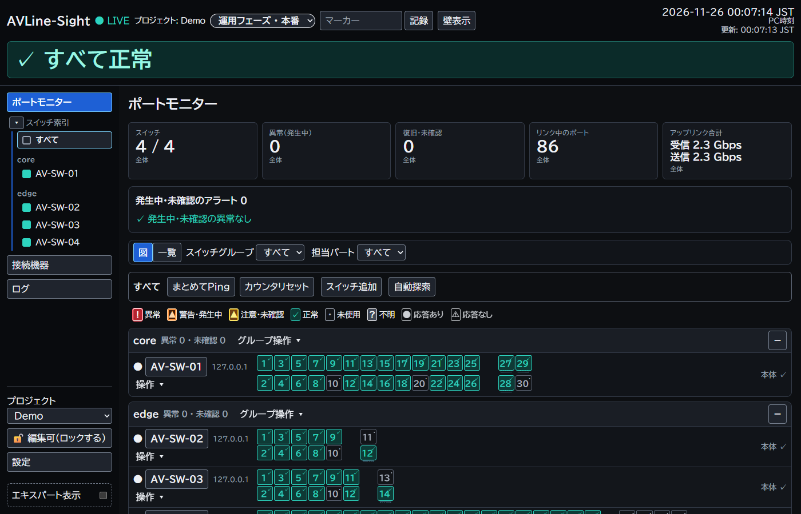
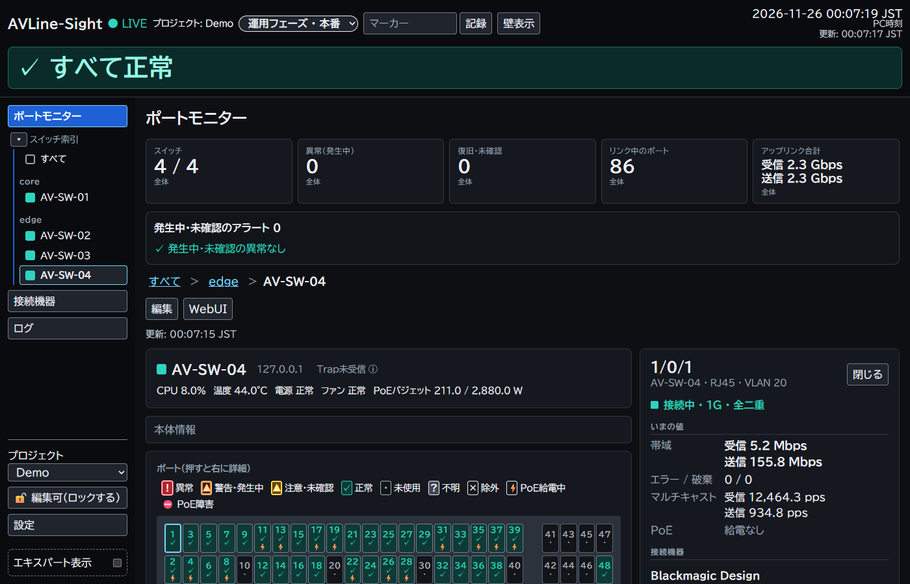
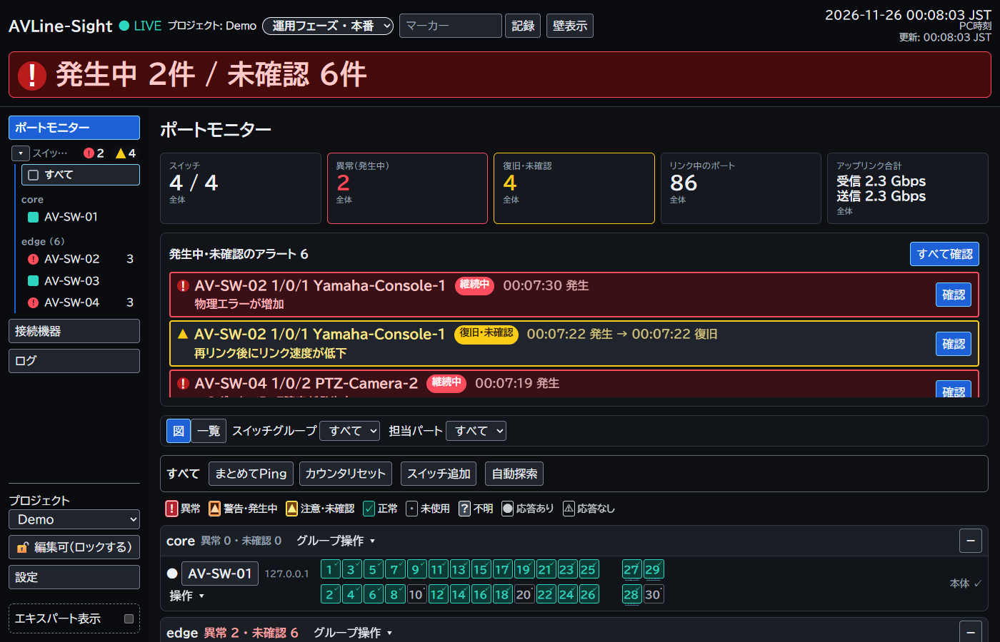

# AVLine-Sight

AVLine-Sight は、NETGEAR AV Line（M4250シリーズ）で組んだ AV over IP ネットワーク（Dante / AES67 / NDI / SDVoE / ST 2110 / Q-SYS / sACN / AVB）の監視ソフトです。
WebUIを同梱した持ち運び可能なWindows用の単一実行ファイルです。監視データは既定で実行ファイルと同じ階層の `./data/` に保存します。

> **非公式ツールです。** AVLine-Sight は個人の独立したプロジェクトで、NETGEARとは関係がなく、NETGEARの承認やサポートを受けたものではありません。NETGEAR・AV Line・M4250 はNETGEAR, Inc.の名称または商標で、本ツールが対応するスイッチを示すためにだけ使っています。その他の製品名（Dante・Q-SYS など）はそれぞれの権利者に帰属します。

英語版は [README.md](README.md) を参照してください。

## 画面

写真はすべて内蔵のラボ（仮想スイッチ）で撮ったもので、実機ではありません。

| ポートモニター（全スイッチ） | 1台表示とポート詳細 | 障害が起きたとき |
|---|---|---|
|  |  |  |

## 監視画面

- **ポートモニター**は起動時に開きます。図（ラック表示）と一覧を切り替えて、スイッチやポートの状態を確認できます。アラート帯には発生中・未確認のアラートを表示します。グループで絞り込んでいても、全体状態にはすべてのスイッチが反映されます。
- **接続機器**では、検出済み・登録済みの機器、接続先のスイッチとポート、予定IPと観測IP、直近のPing結果を確認できます。一覧はCSVで書き出せます。
- **ログ**では、イベントとマーカーを時系列に表示します。異常・警告、未確認のイベント、マーカーなどで絞り込めます。時刻はPC受信時刻（JST）です。
- **壁表示**では、スイッチ別の現在状態と未確認アラートを共用モニターで見やすく表示します。
- **エキスパート表示**は既定でオフです。設定でオンにすると、詳細、トポロジー、Telnet/SSHターミナルを開けます。詳細には「マルチキャスト・AV」「DHCP」「ヘルス・監査」「設定変更」「推奨と違う設定」があります。ターミナルの接続先は登録済みのスイッチに限られ、認証情報は保存しません。10分間操作がなければ切断します。

## 運用フェーズと本番後レポート

| フェーズ | 監視の動作 |
|---|---|
| 設営 | 登録機器に定期Pingを行います。ポートのアラート、機器消失、Ping失敗、IP不一致は抑止します。ポーリング間隔はFastとMediumが設定値の3倍、Slowが2倍です。 |
| リハ | すべてのアラートを有効にし、登録機器に定期Pingを行います。ポーリング間隔は設定値どおりです。 |
| 本番 | すべてのアラートを有効にし、設定値どおりの間隔でポーリングします。定期Pingは停止します。 |

本番に切り替えるときは **本番前チェック**を確認します。スイッチへの到達、Trap受信、時刻ずれ、登録機器やアラートの状態などを確認できます。要確認や判定中の項目が残っている場合は、残項目を確認したうえで本番を開始します。残項目はログに記録され、本番開始時にベースラインを保存します。

設定の **本番後レポート（CSV）** から、直近に記録された本番期間を書き出せます。ログで開始・終了時刻を指定して同じボタンを使うと、その期間を書き出せます。CSVにはフェーズ変更、本番前チェックの残項目、マーカー、アラートの発生・復旧・確認などが入り、時刻はJSTです。

## 主な監視機能

- SNMPv2cを3段階周期（Fast / Medium / Slow）でポーリングします。スイッチごとに独立したワーカーで動きます。応答しないスイッチの確認間隔は5秒、15秒、30秒と延ばします。
- SNMP Trapを受信します（linkUp/Down、LLDP、PoE、ファン、電源、温度、STP、IP重複、CPU）。未定義のTrapも生のOIDのまま保存します。
- 筐体ヘルスでは、CPU（5秒/60秒/300秒）、プロセス別CPU、メモリ、Mbuf、温度、ファン、電源を監視し、sysUpTimeで再起動を検知します。スイッチと監視PCの時刻差を測定し、60秒を超えると `CLOCK_SKEW` で警告します。両方の時刻同期を確認してください。
- LLDP、DHCP Snooping、ARP、FDBとOUIベンダー辞書、手動ラベルで機器を特定します。接続履歴は時系列で表示します。
- AV向けチェックでは、IGMPクエリア、マルチキャストのグループ別ポート、EEE/LPI、PAUSEフレーム（NDI4は例外）、CoSキューのドロップ、DSCP Trust、FrameTooLongs（MTU不一致）、UDLD、SFP DOM、PoE障害、STP/MSTP、二重DHCP・不正DHCPサーバーを確認します。エキスパート表示では、NETGEAR ProAVガイドに基づくスイッチ横断監査も確認できます。
- PVID、EEE、最大フレームなどの監視対象のポート設定が変わると、変更前後の値を `PORT_CONFIG_CHANGED` イベントとしてログに記録します。エキスパート表示では、最新ベースラインとの差分と最近の設定変更を確認できます。
- ベースラインの保存と比較、`M` キーでのインシデント・マーカー追加、オフライン再生用の `.avsight` セッション書出、監視データのCSV/JSON出力ができます。

## 使い方

```powershell
.\avline-sight.exe --open
```

WebUIの既定アドレスは `localhost:8080` です。UDP 162でTrapを待ち受けできない場合も、監視を続けて警告を表示します。Windowsの「SNMP Trap」サービスがポートを使用しているか、権限が足りない可能性があります。待受ポートは起動時に `--trap` で変更できます（例: `--trap 0.0.0.0:1162`）。

| オプション | 既定値 | 内容 |
|---|---|---|
| `--listen` | `127.0.0.1:8080` | WebUIの待受アドレス。ポートが使用中なら最大20番先まで試します。 |
| `--trap` | 保存済みアドレス、または `0.0.0.0:162` | SNMP Trapの待受アドレス。 |
| `--data` | `<exeの場所>/data` | データベースの保存先。 |
| `--config` | 下記の初回起動時の検索 | 起動時にJSON設定ファイルを適用します。明示的に指定したファイルは、既存データがあっても適用します。 |
| `--fast/--medium/--slow` | `3s/12s/45s` | ポーリング周期。 |

## 設定ファイル

**設定** → **設定ファイルを読み込む** でJSONファイルを選び、差分を確認します。適用すると新しい現場が登録され、その現場に切り替わります。**設定ファイルを書き出す** で現在の現場を `avline-sight.config.json` として保存できます。書き出したファイルにSNMPコミュニティは含まれません。認証情報が必要なスイッチは、SNMPコミュニティを入力するとポーリングを開始できます。

データベースに現場がない初回起動時は、実行ファイルと同じ階層に置いた `avline-sight.config.json` を読み込みます。自動読込に成功すると `CONFIG_AUTO_IMPORTED` が記録されます。別の場所のファイルを読み込みたい場合は、`--config .\avline-sight.config.json` のようにパスを渡せます。

## SNMP Trapの受信を確認する

Trapを受信すると、ポーリングの間に起きた短いリンク断を検知しやすくなります。Trapの受信が止まっても監視は続きます。

1. 受信できているあいだ、画面上部には何も出ません。受信できないときだけ **⚠ Trap受信停止** が出るので、出ていたら次の手順へ進みます。Trapをまだ1度も受け取っていないスイッチは、1台表示の名前の横に **Trap未受信 ⓘ** が出ます（何も起きていないだけのこともあります）。そのスイッチの送信先設定を確認してください。
2. UDP 162を使っているものをPowerShellで確認します。

```powershell
Get-NetUDPEndpoint -LocalPort 162 -ErrorAction SilentlyContinue | Select-Object LocalAddress, OwningProcess
Get-Service SNMPTRAP -ErrorAction SilentlyContinue
```

3. ポートが使用中なら、停止できる場合はWindowsの「SNMP Trap」サービスを止めます。または、`--trap` で別のポートを指定してアプリを起動し、スイッチの送信先にも同じポートを指定します。WindowsファイアウォールでそのポートのUDP受信を許可していることを確認してください。
4. スイッチの設定後に、最終Trap時刻が更新されることを確認します。CLIの設定例は実機での確認が必要です。[API仕様](docs/api.md#snmp-trap)

## 複数のPCで見る

監視PCの1台でアプリを `--listen 0.0.0.0:8080` で起動し、閲覧専用ロックを併用します。他のPCでは `http://<監視PCのIP>:8080` を開きます。アラートの確認、運用フェーズ、ロックの変更は接続中のブラウザーに共有されます。

## ビルド

Go 1.26.3以上とNode.js 20以上が必要です。

```powershell
pwsh scripts/build.ps1 -Version 0.2.0
```

WebUIを `web/dist` にビルドし、`internal/` 配下のGoテストを実行して、`bin/avline-sight.exe` を生成します。

## 資料

- [API仕様](docs/api.md)
- NETGEAR M4250 FW 13.0.7.6のMIBを使用します。`internal/mib` のOIDはすべてMIBファイルと機械的に照合済みです。

## 既知の制約

- M4250実機での動作確認は今後の課題です。初めて実機につなぐときは、開発者向けAPIのプローブ（`POST /api/switches/:id/probe`）と診断ダンプ（`GET /api/switches/:id/diagnostic-dump`）で機種ごとの値を確認してください。たとえばSFP DOMの換算値（`DBmHundreths`、現在は100で除算）です。
- OUI辞書には主要ベンダーを収録しています。QSC、Biamp、MA Lighting、Clear-Com、BirdDogは未収録です。
- SSHのホスト鍵は固定（ピン留め）しません。接続時に表示される指紋を照合してください。
- SNMPv3、外部通知、sFlow、SNMP SETによる操作はv2で対応予定です。
## ライセンス

MIT License です。[LICENSE](LICENSE) を参照してください。
